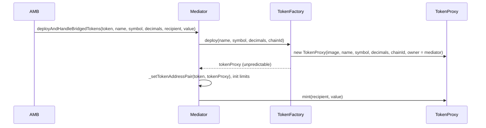
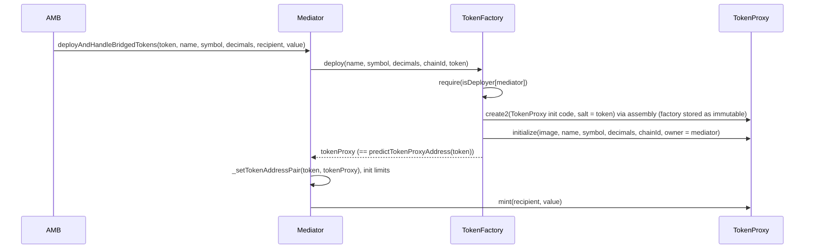

# What

New bridged tokens are deployed with CREATE2, so their address is known before the first bridge transfer.

- Address = `keccak256(0xff ++ TokenFactory ++ salt ++ keccak256(TokenProxy init code))[12:]`
- `salt` = source chain token address (`bytes32(uint256(uint160(token)))`).
- The TokenProxy init code has no constructor arguments, so it is the same for every token. The address therefore
  depends only on the **TokenFactory address** and the **source token address**.
- The TokenFactory is deployed through the EIP-7997 factory (`0x4e59b44847b379578588920cA78FbF26c0B4956C`), so the
  same deployer and salt give the same factory address on every chain.

Not changed:

- Tokens already bridged keep their current address. The mediator still stores the pair, and the stored address wins.
- Token logic (PermittableToken image), ownership (the mediator owns the token and is its bridge contract) and the
  mint/burn flow are unchanged.

# How

| Contract          | Change                                                                                                                                                                                                                                                                                                                                                                                                                                                                                                        |
| ----------------- | ------------------------------------------------------------------------------------------------------------------------------------------------------------------------------------------------------------------------------------------------------------------------------------------------------------------------------------------------------------------------------------------------------------------------------------------------------------------------------------------------------------- |
| `TokenProxy`      | No constructor arguments. Constructor stores the factory as an immutable. New `initialize(...)`, callable once and only by that factory, sets the image, name, symbol, decimals, owner, bridge and `DOMAIN_SEPARATOR`.                                                                                                                                                                                                                                                                                        |
| `TokenFactory`    | `deploy(name, symbol, decimals, chainId, token)` calls `_deployTokenProxy(token)`, which runs the `create2` opcode in inline assembly on `type(TokenProxy).creationCode` with the token as salt, and reverts (bubbling up the reason) if `create2` returns 0, e.g. the address is already taken. Then it calls `initialize`. Only addresses with `isDeployer[addr] == true` can deploy (set by owner with `setDeployer`), so nobody else can take a predicted address. New `predictTokenProxyAddress(token)`. |
| `BasicOmnibridge` | Passes the source token to `deploy`. New view `bridgedTokenAddressOrPredicted(nativeToken)`. Inherited by `HomeOmnibridge` and `ForeignOmnibridge`.                                                                                                                                                                                                                                                                                                                                                           |

Rollout per chain:

1. Deploy the new `TokenFactory` through EIP-7997, configure it (token image, `setDeployer(mediator, true)`), and hand
   ownership to the bridge owner.
2. Upgrade the mediator to the new implementation and point it to the new factory (see
   [Bridge upgrade procedure](#bridge-upgrade-procedure)).

`TokenProxy` is not deployed separately: the factory deploys one per new token.

# For Developer

Call on the mediator of the **destination** chain:

```solidity
address bridged = mediator.bridgedTokenAddressOrPredicted(nativeTokenOnSourceChain);
```

- Already bridged: returns the stored address (it may be an old, non-deterministic one).
- Not bridged yet: returns `tokenFactory().predictTokenProxyAddress(nativeToken)`, where the token will be deployed
  on the first transfer.

```bash
cast call $MEDIATOR "bridgedTokenAddressOrPredicted(address)(address)" $NATIVE_TOKEN --rpc-url $RPC
```

Caveats:

- The prediction is tied to the current factory. If the bridge owner later calls `setTokenFactory`, predictions for
  tokens not yet bridged change.
- Use one factory per mediator. Two mediators sharing a factory would collide on the same source token address, and
  the second `deploy` reverts.

# Technical details

Before (CREATE, address depends on the factory nonce):



After (CREATE2, address = f(factory, token)):



Gas: the first transfer of a new token costs more (measured ~689k vs ~475k on master), because initialization
code now sits in the TokenProxy runtime (1,394 B vs 328 B). This is above the current 600k default for Gnosis ->
Ethereum messages.

# Bridge upgrade procedure

Do this on each chain (Ethereum: ForeignOmnibridge `0x88ad09518695c6c3712AC10a214bE5109a655671`; Gnosis:
HomeOmnibridge `0xf6A78083ca3e2a662D6dd1703c939c8aCE2e268d`).

| #   | Who                                                                              | Call                                                                                                                                  | Notes                                                                                                                                                                                                                                          |
| --- | -------------------------------------------------------------------------------- | ------------------------------------------------------------------------------------------------------------------------------------- | ---------------------------------------------------------------------------------------------------------------------------------------------------------------------------------------------------------------------------------------------- |
| 1   | Any deployer                                                                     | `DeployTokenFactory.s.sol` (EIP-7997 deploy, `setTokenImage(image)`, `setDeployer(mediator, true)`, `transferOwnership(bridgeOwner)`) | Reuse the existing token image (`PermittableToken`) of the chain. Same deployer + `TOKEN_FACTORY_SALT` gives the same factory address on both chains.                                                                                          |
| 2   | Any deployer                                                                     | Deploy the new `HomeOmnibridge(suffix)` (Gnosis) / `ForeignOmnibridge(suffix)` (Ethereum) implementation                              | Use the same name suffix as the live implementation (check the name of an existing bridged token). `UpgradeOmnibridge.s.sol` does this and prints the calls of step 4.                                                                         |
| 3   | Gas limit manager owner (Gnosis, `0x68A3674028a785A8BCE19bA81B9ab7c9942BA3ED`)   | `setRequestGasLimit(0x2ae87cdd, gas)` and `setRequestGasLimit(0xd522cfd7, gas)`, gas ≥ 1,000,000 (suggested)                          | Selectors of `deployAndHandleBridgedTokens` and `deployAndHandleBridgedTokensAndCall`. Do this before upgrading the Ethereum side: the new deploy path needs ~689k, above the 600k default. Ethereum -> Gnosis messages already get 2,000,000. |
| 4   | Proxy upgradeability owner **and** bridge owner, in **one Safe MultiSend batch** | `proxy.upgradeTo(version() + 1, newImplementation)` then `mediator.setTokenFactory(newFactory)`                                       | Order matters: the old implementation calls `deploy` with 4 arguments and would fail against the new factory. `setTokenFactory` is `onlyOwner`, so it cannot go through `upgradeToAndCall`.                                                    |

Check after the upgrade:

- `mediator.tokenFactory() == newFactory`
- `factory.isDeployer(mediator) == true`, `factory.owner() == bridgeOwner`, `factory.tokenImage() == image`
- `mediator.bridgedTokenAddressOrPredicted(t)` returns the stored address for a bridged token and
  `factory.predictTokenProxyAddress(t)` for a new one.
- Bridge a test token that was never bridged and check it lands at the predicted address.

Messages already sent before the upgrade carry their old gas limit. A Gnosis -> Ethereum `deployAndHandleBridgedTokens`
message sent with 600k fails on the new Ethereum code and must be refunded with `requestFailedMessageFix`.

# For bridge governors & verification purpose

# Audit

# Dev

1. Testing
2. Virtual Testnet
3. UI
